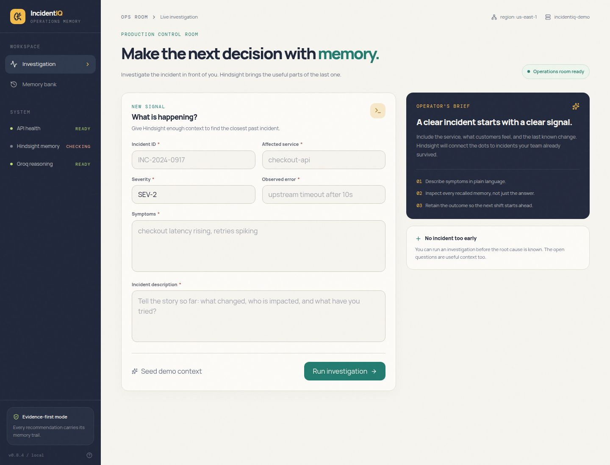
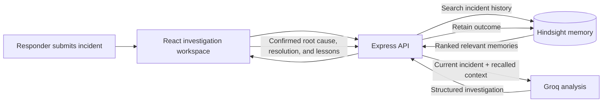

<div align="center">

# IncidentIQ

### Turn past incident experience into a better starting point for the next one.

IncidentIQ is an AI-assisted incident investigation workspace for software and DevOps teams. It searches persistent memory for similar incidents, gives that historical context to an AI analysis service, and shows responders the evidence behind the suggestions. Once an incident is resolved, the team can retain what it learned for future investigations.

[](https://incident-iq-manager--chandrikapasup1.replit.app)
[](https://github.com/chandrika131105/IncidentIQ)

<br />


</div>

<br />

<p align="center">
  
</p>

<p align="center"><sub>Investigation workspace · Describe an incident, inspect relevant history, and retain the team's findings.</sub></p>

---

## Why IncidentIQ?

When a production issue occurs, responders often have to piece together what happened from alerts, logs, documentation, and conversations. The team may already have solved a similar problem, but that experience can be difficult to find while an incident is unfolding.

IncidentIQ is designed to make that operational history useful at investigation time. A responder enters the current incident, the system searches previously retained incident memories, and an AI service uses the current details and recalled context to generate a structured analysis.

The goal is not to replace responders or automatically declare a root cause. It is to help teams start with relevant evidence, make the reasoning easier to inspect, and preserve confirmed lessons for the next incident.

## How an investigation works

<table>
  <tr>
    <td width="25%" valign="top">
      <h3>01 · Describe</h3>
      Enter the incident ID, affected service, severity, observed error, symptoms, and description.
    </td>
    <td width="25%" valign="top">
      <h3>02 · Recall</h3>
      IncidentIQ searches Hindsight for relevant historical memories and returns ranked results with relevance details.
    </td>
    <td width="25%" valign="top">
      <h3>03 · Investigate</h3>
      The API sends the incident and recalled context to Groq for a structured analysis, including probable causes and a recommended resolution.
    </td>
    <td width="25%" valign="top">
      <h3>04 · Learn</h3>
      After the incident is understood, retain its confirmed root cause, resolution, outcome, and lessons for future recall.
    </td>
  </tr>
</table>



Hindsight is the source of persistent incident memory. If memory is not configured or no relevant results are found, the API reports that state; it does not invent recalled incidents.

## What the analysis contains

The investigation response is designed to give responders a useful starting point while keeping the evidence visible:

- **Incident summary** based on the submitted details.
- **Probable root-cause signals** for the responder to investigate.
- **Recommended resolution** generated from the current incident and any recalled context.
- **Confidence** associated with the generated analysis.
- **Recalled memories** with incident identifiers, relevance, and an explanation of why they matched.
- **Investigation trace** showing the main steps from incident submission to recommendations.
- **Warnings** when memory is unavailable or no relevant historical incidents were found.

Recommendations are decision support—not proof. Responders should check hypotheses against current telemetry and production evidence.

## Project capabilities

<table>
  <tr>
    <td width="50%" valign="top">
      <strong>Evidence-informed incident analysis</strong><br />
      Bring the current incident and relevant operational history together in one investigation flow.
    </td>
    <td width="50%" valign="top">
      <strong>Inspectable memory recall</strong><br />
      Review the memories that informed an analysis, search the archive, and see why results were considered relevant.
    </td>
  </tr>
  <tr>
    <td width="50%" valign="top">
      <strong>Persistent learning loop</strong><br />
      Record what the team confirmed after an incident so future investigations can use that experience.
    </td>
    <td width="50%" valign="top">
      <strong>Demo data and memory browser</strong><br />
      Seed eight realistic example incidents and browse retained memories in the history page.
    </td>
  </tr>
</table>

## Example demo workflow

The demo includes historical incidents across payment, authentication, order, notification, and database services.

1. Open the [live demo](https://incident-iq-manager--chandrikapasup1.replit.app).
2. Choose **Seed demo context** to retain the sample incidents in the configured Hindsight bank.
3. Submit a new Payment API incident with HTTP 500 errors and database connection timeouts.
4. Review the recalled memories and the AI-generated analysis.
5. Verify any suggested causes against the incident's actual evidence.
6. Retain the confirmed outcome so it can inform future investigations.

One seeded example, `INC-101`, describes Payment API failures caused by database connection-pool exhaustion after a connection leak. It illustrates how a previous root cause and resolution can provide useful context for a similar new signal.

## Architecture and technology

| Layer | Technology | Responsibility |
| --- | --- | --- |
| Web application | React, TypeScript, Vite, Tailwind CSS | Incident workspace, analysis display, and searchable memory history |
| API service | Node.js, Express, TypeScript | Validates requests and coordinates memory recall, analysis, and retention |
| Persistent memory | Hindsight Cloud | Stores, recalls, searches, and retains incident memories |
| AI analysis | Groq chat completions | Generates structured investigation output from incident and recalled context |
| API contract | OpenAPI | Defines shared request and response schemas |
| Generated client | Orval, React Query, Zod | Provides frontend API hooks and schema-based validation |

The Groq model defaults to `openai/gpt-oss-120b` and can be changed with `GROQ_MODEL`.

## API endpoints

| Method | Endpoint | Purpose |
| --- | --- | --- |
| `GET` | `/api/health` | Check API health and integration configuration |
| `GET` | `/api/memory/status` | Check Hindsight reachability and configured bank |
| `POST` | `/api/incidents/investigate` | Recall memories and generate an incident analysis |
| `GET` | `/api/incidents/memories?query=...` | Search retained incident memories |
| `POST` | `/api/incidents/retain` | Retain a confirmed incident outcome |
| `POST` | `/api/incidents/seed-demo` | Add the eight demo incidents to Hindsight |

## Run locally

### Requirements

- Node.js
- pnpm
- A Groq API key to generate investigations
- Hindsight Cloud credentials for persistent recall and retention

Install dependencies from the repository root:

```bash
pnpm install
```

Configure the API server with the environment variables listed below. Keep secrets in your shell environment or a secrets manager; do not commit real keys.

In one terminal, build and start the API server:

```bash
pnpm --filter @workspace/api-server run build
pnpm --filter @workspace/api-server run start
```

In a second terminal, start the frontend:

```bash
pnpm --filter @workspace/incidentiq run dev
```

The frontend's Vite development server proxies `/api` requests to the API server.

## Configuration

| Variable | Purpose |
| --- | --- |
| `GROQ_API_KEY` | Server-side Groq API key; required for AI investigations |
| `GROQ_MODEL` | Groq model ID; defaults to `openai/gpt-oss-120b` |
| `HINDSIGHT_API_KEY` | Hindsight Cloud API key |
| `HINDSIGHT_API_URL` | Hindsight base URL; defaults to `https://api.hindsight.vectorize.io` |
| `HINDSIGHT_BANK_ID` | Hindsight memory bank; defaults to `incidentiq-demo` |

See `.env.example` for the variable names and defaults. API credentials are used by the server and must not be exposed in frontend code or committed to the repository.

## Repository map

```text
artifacts/
├── api-server/src/
│   ├── lib/incidentiq.ts            # Hindsight integration and Groq analysis
│   └── routes/incidents.ts          # Incident and memory API routes
└── incidentiq/src/
    └── pages/
        ├── workspace.tsx            # Investigation and outcome-retention flow
        └── history.tsx               # Searchable memory archive
lib/
└── api-spec/openapi.yaml            # Shared API contract
screenshots/
└── incidentiq-final.jpg             # README product screenshot
```

## Reliability and safety notes

- API request bodies are validated using schemas generated from the OpenAPI contract.
- Provider credentials remain server-side.
- Provider failures return safe API messages rather than exposing credentials or stack traces.
- Missing Hindsight configuration is reported; recalled memories are not fabricated.
- AI-generated analysis and historical similarity are aids for responders, not a substitute for production evidence.

## Current scope

IncidentIQ is a focused prototype for demonstrating memory-assisted incident investigation. The current implementation does not include authentication, team permissions, live alerting, on-call integrations, or direct observability and deployment telemetry integrations. The demo uses a controlled set of sample incidents rather than a production organization's complete incident history.

---

<p align="center">
  <sub>IncidentIQ helps teams turn resolved incidents into useful context for the next investigation.</sub>
</p>
