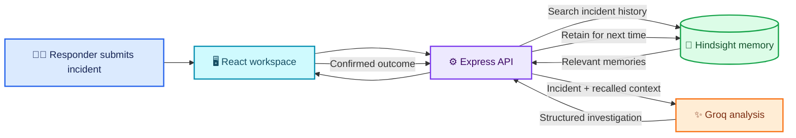

<div align="center">

# 🧠 IncidentIQ

### 🚨 Turn past incident experience into a better starting point for the next one.

**IncidentIQ** is an AI-assisted incident investigation workspace for software and DevOps teams. It finds relevant incident history, uses that context to help generate an investigation, and lets teams retain confirmed outcomes for the future.

<br />

[](https://incident-iq-manager--chandrikapasup1.replit.app)
[](https://github.com/chandrika131105/IncidentIQ)

<br />


</div>

<br />

<p align="center">
  
</p>

<p align="center">
  <strong>Investigate.</strong> <strong>Learn.</strong> <strong>Be better prepared next time.</strong>
</p>

---

## ✨ What is IncidentIQ?

When a production incident happens, responders need to understand the current signal quickly. But useful clues may be buried in old tickets, chat threads, or the memory of someone who handled a similar outage before.

IncidentIQ brings that operational history into the investigation workflow.

A responder describes an incident. IncidentIQ searches **Hindsight** for related memories and passes the current incident and recalled context to **Groq** to generate a structured analysis. The responder can inspect the evidence, decide what applies, and retain the confirmed outcome for future investigations.

> **The goal:** help responders find useful context faster—not replace their judgment or claim that a historical match proves the current root cause.

## 🎯 The investigation workflow

<table>
  <tr>
    <td width="25%" align="center" valign="top">
      <h3>📝 01 · Describe</h3>
      Enter the incident ID, affected service, severity, error, symptoms, and description.
    </td>
    <td width="25%" align="center" valign="top">
      <h3>🔎 02 · Recall</h3>
      Search Hindsight for relevant historical incidents and inspect why they matched.
    </td>
    <td width="25%" align="center" valign="top">
      <h3>🤖 03 · Investigate</h3>
      Generate probable causes and a recommended resolution using the incident and recalled context.
    </td>
    <td width="25%" align="center" valign="top">
      <h3>🔁 04 · Learn</h3>
      Retain the confirmed root cause, resolution, outcome, and lessons for future use.
    </td>
  </tr>
</table>



## 💡 What the analysis provides

| Output | What it means |
| --- | --- |
| 📋 **Incident summary** | A concise readout based on the incident details submitted |
| 🧩 **Probable root-cause signals** | Potential causes for the responder to investigate |
| ✅ **Recommended resolution** | An AI-generated recommendation based on the current incident and available memory |
| 📊 **Confidence** | The confidence value returned with the generated analysis |
| 🧠 **Recalled memories** | Historical incidents with relevance and matching context |
| 🧭 **Investigation trace** | A trace of the main steps from incident submission to recommendation |
| ⚠️ **Warnings** | Notice when memory is unavailable or no relevant incidents were found |

**Recommendations are decision support, not proof.** Responders should verify hypotheses against current telemetry and production evidence.

## 🌈 Project highlights

<table>
  <tr>
    <td width="50%" valign="top">
      <h3>🔍 Explainable incident recall</h3>
      Search retained incident memories and see which results were returned, how relevant they are, and why they may match.
    </td>
    <td width="50%" valign="top">
      <h3>🧠 Persistent operational memory</h3>
      Hindsight stores and recalls incidents so the team's confirmed experience can inform later investigations.
    </td>
  </tr>
  <tr>
    <td width="50%" valign="top">
      <h3>🔁 A complete learning loop</h3>
      Record the actual root cause, resolution, outcome, and lessons after an incident is understood.
    </td>
    <td width="50%" valign="top">
      <h3>🧪 A ready-to-try demo</h3>
      Seed eight realistic incidents across payment, authentication, orders, notifications, and database services.
    </td>
  </tr>
</table>

## 🧪 Try the demo

1. Open the [**IncidentIQ live demo**](https://incident-iq-manager--chandrikapasup1.replit.app).
2. Select **Seed demo context** to add eight example incidents to the configured Hindsight bank.
3. Submit a Payment API incident with HTTP 500 errors and database connection timeouts.
4. Review the memories Hindsight recalls and inspect the AI-generated analysis.
5. Verify suggested causes against the incident's actual evidence.
6. Retain the confirmed outcome to make it available to future investigations.

One of the seeded examples, **`INC-101`**, describes Payment API failures caused by database connection-pool exhaustion after a connection leak. It demonstrates how a previous incident can provide useful context for a similar new signal.

## 🏗️ Architecture and technology

| Layer | Technologies | Role |
| --- | --- | --- |
| 🖥️ **Web app** | React, TypeScript, Vite, Tailwind CSS | Incident workspace, analysis display, and searchable memory history |
| ⚙️ **API** | Node.js, Express, TypeScript | Coordinates validation, recall, analysis, and outcome retention |
| 🧠 **Memory** | Hindsight Cloud | Persistent incident recall, search, and retention |
| ✨ **AI analysis** | Groq chat completions | Generates structured analysis from the incident and recalled context |
| 📜 **API contract** | OpenAPI | Defines shared API request and response schemas |
| 🔌 **Frontend client** | Orval, React Query, Zod | Generated API hooks and schema-based validation |

The default Groq model is `openai/gpt-oss-120b`. Change it with the `GROQ_MODEL` environment variable.

## 🔌 API endpoints

| Method | Endpoint | Description |
| --- | --- | --- |
| `GET` | `/api/health` | Check API health and integration configuration |
| `GET` | `/api/memory/status` | Check Hindsight reachability and configured bank |
| `POST` | `/api/incidents/investigate` | Recall memories and generate an incident analysis |
| `GET` | `/api/incidents/memories?query=...` | Search retained incident memories |
| `POST` | `/api/incidents/retain` | Retain a confirmed incident outcome |
| `POST` | `/api/incidents/seed-demo` | Add the eight demo incidents to Hindsight |

## 🚀 Run locally

### Requirements

- Node.js
- pnpm
- A Groq API key for AI-generated investigations
- Hindsight Cloud credentials for persistent recall and retention

Install dependencies from the repository root:

```bash
pnpm install
```

Configure the API server with the environment variables in the next section. Keep secrets in your shell environment or a secrets manager—do not commit real keys.

In one terminal, build and start the API server:

```bash
pnpm --filter @workspace/api-server run build
pnpm --filter @workspace/api-server run start
```

In a second terminal, start the frontend:

```bash
pnpm --filter @workspace/incidentiq run dev
```

## 🔐 Configuration

| Variable | Purpose |
| --- | --- |
| `GROQ_API_KEY` | Server-side Groq API key; required for AI investigations |
| `GROQ_MODEL` | Groq model ID; defaults to `openai/gpt-oss-120b` |
| `HINDSIGHT_API_KEY` | Hindsight Cloud API key |
| `HINDSIGHT_API_URL` | Hindsight base URL; defaults to `https://api.hindsight.vectorize.io` |
| `HINDSIGHT_BANK_ID` | Hindsight memory bank; defaults to `incidentiq-demo` |

See [`.env.example`](.env.example) for the variable names and defaults. **Never expose API credentials in frontend code or commit real keys to the repository.**

## 📂 Repository map

```text
artifacts/
├── api-server/src/
│   ├── lib/incidentiq.ts            # Hindsight integration and Groq analysis
│   └── routes/incidents.ts          # Incident and memory API routes
└── incidentiq/src/
    └── pages/
        ├── workspace.tsx            # Investigation and outcome-retention flow
        └── history.tsx               # Searchable memory archive
lib/
└── api-spec/openapi.yaml            # Shared API contract
screenshots/
└── incidentiq-final.jpg             # README product screenshot
```

## 🛡️ Reliability and responsible use

- API request bodies are validated using schemas generated from the OpenAPI contract.
- Provider credentials stay on the server.
- Provider failures return safe API messages instead of exposing credentials or stack traces.
- Missing Hindsight configuration is reported; recalled memories are not fabricated.
- Historical similarity is a useful lead, not proof of the current root cause.
- AI-generated analysis should be checked against current production evidence.

## 🔭 Current scope

IncidentIQ is a prototype focused on memory-assisted incident investigation. It currently does not include authentication, team permissions, live alerting, on-call integrations, or direct observability and deployment telemetry integrations. Its demo uses a controlled set of sample incidents rather than a production organization's complete incident history.

---

<div align="center">

### 💬 Investigate with context. Learn from every resolution.

**IncidentIQ** helps turn resolved incidents into useful context for the next investigation.

[](https://incident-iq-manager--chandrikapasup1.replit.app)

</div>
