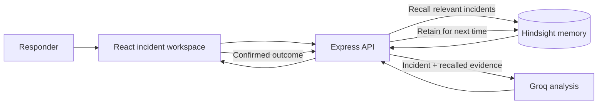

<div align="center">

# IncidentIQ

### Incident response that learns from what your team has already solved.

IncidentIQ pairs AI-assisted investigation with persistent incident memory—so responders can inspect relevant past incidents, understand why they match, and carry confirmed outcomes forward.

[](https://incident-iq-manager--chandrikapasup1.replit.app)
[](https://github.com/chandrika131105/IncidentIQ)

<br />


</div>

<br />

<p align="center">
  
</p>

<p align="center"><sub>Incident workspace · Submit a signal, inspect the evidence trail, and retain what the team learns.</sub></p>

---

## The project, at a glance

<table>
  <tr>
    <td width="33%" valign="top">
      <h3>01 &nbsp; Investigate</h3>
      Describe an incident and get a structured AI readout with probable causes, recommended next steps, and confidence.
    </td>
    <td width="33%" valign="top">
      <h3>02 &nbsp; Ground in history</h3>
      Recall relevant Hindsight memories and inspect the evidence that informed the analysis—not just the answer.
    </td>
    <td width="33%" valign="top">
      <h3>03 &nbsp; Close the loop</h3>
      Retain the confirmed root cause, resolution, outcome, and lessons so future investigations can learn from them.
    </td>
  </tr>
</table>

## How it works



The investigation is evidence-first: historical matches are shown in the UI alongside the analysis, and similarity is a signal for responders to verify—not proof of a root cause. Hindsight is the persistent memory source; the app does not substitute a local vector store or fabricate recalled incidents.

## Features

<table>
  <tr>
    <td width="50%" valign="top">
      <strong>Incident investigation</strong><br />
      Capture incident ID, service, severity, error, symptoms, and description. Receive probable root causes, a recommended resolution, confidence, and a step-by-step trace.
    </td>
    <td width="50%" valign="top">
      <strong>Explainable memory recall</strong><br />
      See ranked historical incidents, relevance, and why each memory matches. Search the retained incident archive by service, symptom, or lesson.
    </td>
  </tr>
  <tr>
    <td width="50%" valign="top">
      <strong>Learning loop</strong><br />
      Record the actual root cause, resolution, outcome, and lessons learned back to Hindsight for future investigations.
    </td>
    <td width="50%" valign="top">
      <strong>Demo-ready context</strong><br />
      Seed eight realistic incidents across payment, authentication, orders, notifications, and database services.
    </td>
  </tr>
</table>

## Run locally

**Requirements:** Node.js and pnpm.

```bash
pnpm install
```

Provide the API server with the variables below (for local development, use your shell or a secrets manager; `.env.example` lists the expected names). In one terminal, build and start the API:

```bash
pnpm --filter @workspace/api-server run build
```

```bash
pnpm --filter @workspace/api-server run start
```

In a second terminal, start the web app:

```bash
pnpm --filter @workspace/incidentiq run dev
```

The server needs a Groq key to generate analyses. Hindsight credentials enable persistent recall and outcome retention; without them, the API reports that memory is unavailable rather than inventing results.

## Configuration

| Variable | Purpose |
| --- | --- |
| `GROQ_API_KEY` | Server-side Groq API key (required for AI investigation) |
| `GROQ_MODEL` | Groq model ID; defaults to `openai/gpt-oss-120b` |
| `HINDSIGHT_API_KEY` | Hindsight Cloud API key |
| `HINDSIGHT_API_URL` | Hindsight base URL; defaults to `https://api.hindsight.vectorize.io` |
| `HINDSIGHT_BANK_ID` | Hindsight memory bank; defaults to `incidentiq-demo` |

Keep credentials out of source control and provide them through environment variables or your deployment platform's secret manager.

## Try the demo

1. Open the [live demo](https://incident-iq-manager--chandrikapasup1.replit.app).
2. Select **Seed demo context** to add eight sample incidents to the configured Hindsight bank.
3. Investigate a new payment incident with symptoms similar to `INC-101` (HTTP 500s and database connection timeouts).
4. Review the recalled evidence and AI readout, then retain the confirmed outcome to complete the learning loop.

## API

| Method | Endpoint | Purpose |
| --- | --- | --- |
| `GET` | `/api/health` | Check API health and integration configuration |
| `GET` | `/api/memory/status` | Check Hindsight status and configured bank |
| `POST` | `/api/incidents/investigate` | Recall context and generate an incident analysis |
| `GET` | `/api/incidents/memories?query=...` | Search retained incident memories |
| `POST` | `/api/incidents/retain` | Retain a confirmed incident outcome |
| `POST` | `/api/incidents/seed-demo` | Seed the eight demo incidents |

## Built with

<table>
  <tr>
    <td><strong>Web</strong></td><td>React · TypeScript · Vite · Tailwind CSS</td>
  </tr>
  <tr>
    <td><strong>API</strong></td><td>Node.js · Express · TypeScript</td>
  </tr>
  <tr>
    <td><strong>AI &amp; memory</strong></td><td>Groq chat completions · Hindsight Cloud</td>
  </tr>
  <tr>
    <td><strong>Contract &amp; client</strong></td><td>OpenAPI · generated Zod schemas · Orval-generated React Query client</td>
  </tr>
</table>

## Project structure

```text
artifacts/
├── api-server/src/
│   ├── lib/incidentiq.ts            # Hindsight recall/retention and Groq analysis
│   └── routes/incidents.ts          # Incident and memory API routes
└── incidentiq/src/
    └── pages/
        ├── workspace.tsx            # Investigation and outcome-retention flow
        └── history.tsx               # Searchable Hindsight memory archive
lib/
└── api-spec/openapi.yaml            # Shared API contract
screenshots/
└── incidentiq-final.jpg             # Product workspace preview
```

## Engineering notes

- The API contract is shared across the server and frontend through generated schemas and client hooks.
- Request bodies are validated against schemas generated from the OpenAPI contract.
- Provider credentials stay on the server; provider failures return safe messages without exposing keys or stack traces.
- Historical similarity helps prioritize investigation and must be checked against current production evidence.

---

<p align="center">
  <sub>Built to help incident responders turn yesterday's hard-won lessons into tomorrow's useful context.</sub>
</p>
