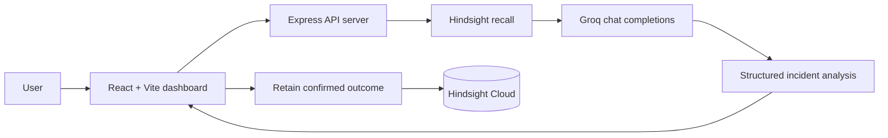

# IncidentIQ

IncidentIQ is an AI incident response agent for software and DevOps teams. It recalls relevant operational history from Hindsight, gives that history to a Groq-powered analysis agent, and lets the team retain the confirmed outcome so future investigations improve.

## The problem

During an incident, responders need more than a generic troubleshooting checklist. They need the team's previous root causes, resolutions, and lessons while the current signal is still changing. IncidentIQ turns those past incidents into persistent, searchable context.

## Why persistent memory matters

The demo is designed around two different behaviors:

- Without memory, a new incident receives a current-context-only analysis.
- With Hindsight memory, a similar incident recalls the previous incident, shows the evidence in the UI, and gives the Groq agent that evidence before it recommends next steps.

Hindsight is the source of truth for incident memory. The app does not use a local vector store, a substitute database, local storage, or a fake recall layer.

## Architecture



The repository's shared backend service is Express/TypeScript, so the API implementation follows the workspace's existing server architecture while keeping the OpenAPI contract shared by the API and React client.

## Hindsight integration

The server uses the official `@vectorize-io/hindsight-client` SDK.

1. The user submits an incident.
2. IncidentIQ builds a natural-language recall query from the incident ID, service, error, symptoms, and description.
3. Hindsight returns ranked historical memories.
4. The API exposes those memories, their incident identifiers, relevance, and why they matched.
5. Groq receives the current incident plus the exact recalled memory text.
6. The UI displays the memory count and the trace from incident to recall to recommendation.
7. The user can retain the confirmed root cause, resolution, outcome, and lessons learned back into Hindsight.

The explicit **Seed demo context** action creates or updates the configured Hindsight bank and retains eight realistic incidents, including `INC-101` for the Payment API connection-pool exhaustion scenario.

## Groq integration

IncidentIQ calls Groq's OpenAI-compatible chat completions endpoint:

`POST https://api.groq.com/openai/v1/chat/completions`

The default model is `openai/gpt-oss-120b`, which is configurable through `GROQ_MODEL`. The server requests a structured JSON response and never sends credentials to the browser.

## API endpoints

- `GET /api/health` — integration configuration status
- `GET /api/memory/status` — Hindsight reachability and configured bank
- `POST /api/incidents/investigate` — recall memories and generate an analysis
- `POST /api/incidents/retain` — retain a confirmed incident outcome
- `GET /api/incidents/memories?query=...` — search historical memory
- `POST /api/incidents/seed-demo` — retain the eight demo incidents

## Environment variables

Copy `.env.example` into your local environment. Store secret values as Replit Secrets.

| Variable | Purpose |
| --- | --- |
| `HINDSIGHT_API_URL` | Hindsight base URL; defaults to `https://api.hindsight.vectorize.io` |
| `HINDSIGHT_API_KEY` | Hindsight Cloud API key |
| `HINDSIGHT_BANK_ID` | Hindsight memory bank; defaults to `incidentiq-demo` |
| `GROQ_API_KEY` | Groq API key |
| `GROQ_MODEL` | Groq model ID; defaults to `openai/gpt-oss-120b` |

## Run the app

```bash
pnpm install
pnpm --filter @workspace/api-server run dev
pnpm --filter @workspace/incidentiq run dev
```

The managed workspace workflows start both services for the preview.

## Demo scenario

1. Click **Seed demo context** in the IncidentIQ workspace.
2. Submit a new incident:
   - Incident ID: `INC-115`
   - Service: `Payment API`
   - Severity: `SEV-1`
   - Error: `HTTP 500`
   - Symptoms: `Database connections are timing out again.`
   - Description: `Payment requests are failing after a recent deployment.`
3. Run the investigation.
4. Confirm that Hindsight returns `INC-101` and that the readout references database connection pool exhaustion, connection leaks, pool utilization, and deployment changes.
5. Retain the confirmed outcome so the next similar incident has more context.

## Failure handling

- Missing Groq configuration blocks investigation with a safe configuration message.
- Missing Hindsight configuration returns a truthful no-memory warning.
- Hindsight outages do not fabricate recalled memories; the analysis explicitly says when no historical memory was used.
- Groq failures return a safe upstream error without exposing keys or stack traces.
- Request bodies are validated with schemas generated from the OpenAPI contract.

## Limitations and future improvements

- IncidentIQ currently keeps the incident workspace focused on a single active investigation.
- Authentication, team permissions, on-call integrations, live telemetry, and deployment context are intentionally out of scope for the hackathon demo.
- A production version could add incident timelines, role-based access, provider adapters for alerts, and retention analytics.