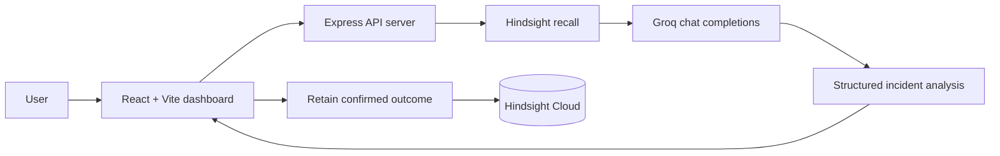

# IncidentIQ

IncidentIQ is an AI incident-response agent for software and DevOps teams. It recalls relevant operational history from Hindsight, gives that history to a Groq-powered analysis agent, and lets the team retain confirmed outcomes so future investigations can use that experience.

## The Problem

During an incident, responders need more than a generic troubleshooting checklist. They need previous root causes, resolutions, and lessons while the current signal is still changing.

IncidentIQ turns those past incidents into persistent, searchable context.

## Why Persistent Memory Matters

IncidentIQ is designed around two different behaviors:

- **Without memory:** A new incident can be analyzed using only its current context.
- **With Hindsight memory:** A similar incident can recall previous operational experience, show the evidence in the UI, and provide that evidence to the Groq analysis agent before it recommends next steps.

Hindsight is the source of truth for IncidentIQ's persistent incident memory. The application does not use a local vector store or a fake recall layer as a substitute for Hindsight.

## Architecture



The backend uses Express and TypeScript. The OpenAPI contract is shared by the API and React client.

## Hindsight Integration

The server uses the official `@vectorize-io/hindsight-client` SDK.

The investigation flow is:

1. The user submits an incident.
2. IncidentIQ builds a recall query from the incident ID, service, error, symptoms, and description.
3. Hindsight returns ranked historical memories.
4. The API exposes the recalled memories, incident identifiers, relevance, and matching explanation.
5. Groq receives the current incident together with the recalled Hindsight memory text.
6. The UI displays the memory count and a trace from the current incident through recall to the recommendation.
7. The user can retain the confirmed root cause, resolution, outcome, and lessons learned back into Hindsight.

The **Seed demo context** action creates or updates the configured Hindsight bank and retains eight realistic incidents, including `INC-101`, the Payment API connection-pool exhaustion scenario.

## Groq Integration

IncidentIQ calls Groq's OpenAI-compatible chat-completions endpoint.

The default model is `openai/gpt-oss-120b`, configurable through `GROQ_MODEL`.

The server keeps the Groq API credential out of the browser and requests a structured JSON response from the model.

## API Endpoints

- `GET /api/health` — integration configuration status
- `GET /api/memory/status` — Hindsight reachability and configured bank
- `POST /api/incidents/investigate` — recall memories and generate an analysis
- `POST /api/incidents/retain` — retain a confirmed incident outcome
- `GET /api/incidents/memories?query=...` — search historical memory
- `POST /api/incidents/seed-demo` — retain the eight demo incidents

## Environment Variables

Copy `.env.example` into your local environment.

Store secret values in a secure environment such as Replit Secrets or your deployment provider's secret manager.

| Variable | Purpose |
|---|---|
| `HINDSIGHT_API_URL` | Hindsight base URL; defaults to `https://api.hindsight.vectorize.io` |
| `HINDSIGHT_API_KEY` | Hindsight Cloud API key |
| `HINDSIGHT_BANK_ID` | Hindsight memory-bank identifier; use a unique bank for your own deployment |
| `GROQ_API_KEY` | Groq API key |
| `GROQ_MODEL` | Groq model ID; defaults to `openai/gpt-oss-120b` |

**Never commit real API keys or `.env` files to the repository.**

## Run the App

```bash
pnpm install
pnpm --filter @workspace/api-server run dev
pnpm --filter @workspace/incidentiq run dev
```

The managed workspace workflows start both services for the preview.

## Verified Demonstration

The verified IncidentIQ demonstration uses a clean Hindsight memory bank containing eight seeded historical incidents.

### Historical Incident — INC-101

The Payment API experienced HTTP 500 errors and database connection timeouts.

The recorded root cause was database connection-pool exhaustion caused by a connection leak.

The resolution was to fix the connection leak and increase the connection-pool size.

### New Incident — INC-115

The demonstration then submits:

- **Incident ID:** `INC-115`
- **Service:** `Payment API`
- **Severity:** `SEV-2`
- **Error:** `HTTP 500 errors and database connection timeouts`
- **Symptoms:** `Intermittent payment failures, HTTP 500 errors, database connection timeouts`
- **Description:** `The Payment API is intermittently failing with HTTP 500 errors. Database connections are timing out and payment requests are failing for some customers.`

The verified workflow recalled **six memories**, with `INC-101` shown as a **100% match**.

Groq then generated a structured investigation with:

- **88% confidence**
- **3 root-cause signals**
- **4 investigation steps**

The confirmed outcome for `INC-115` was subsequently retained in Hindsight, and `INC-115` appeared in the memory bank after retention.

## The Learning Loop

```text
Current Incident
      ↓
Hindsight Recall
      ↓
Historical Context
      ↓
Groq Analysis
      ↓
Investigation / Resolution
      ↓
Retain Confirmed Outcome
      ↓
Hindsight Memory
```

This creates a feedback loop where confirmed incident outcomes become available as context for future investigations.

## Failure Handling

IncidentIQ is designed to avoid presenting fabricated memory or unsafe diagnostic information.

- Missing Groq configuration blocks investigation with a safe configuration message.
- Missing Hindsight configuration returns a truthful no-memory warning.
- Hindsight failures do not fabricate recalled memories.
- Groq failures return a safe upstream error without exposing API keys or stack traces.
- Request bodies are validated with schemas generated from the OpenAPI contract.

## Limitations and Future Improvements

IncidentIQ is a focused prototype rather than a complete production incident-management platform.

### Current Limitations

- The incident workspace focuses on a single active investigation.
- Authentication and team permissions are not part of the current prototype.
- Live monitoring, alerting, deployment telemetry, and on-call integrations are not connected.
- The demonstration uses a controlled set of realistic incident records rather than a large production incident history.
- Historical similarity is an investigation signal, not proof of the current root cause. Responders should verify hypotheses against current telemetry and production evidence.

### Future Improvements

A production-oriented version could add:

- Incident timelines
- Role-based access
- Alerting integrations
- Observability platform integrations
- Richer deployment context
- Retention and learning analytics
- Larger organizational incident histories

## Project Structure

```text
artifacts/
├── api-server/
│   └── src/
│       ├── lib/
│       │   └── incidentiq.ts
│       └── routes/
│           └── incidents.ts
└── incidentiq/
    └── src/
        └── pages/
            ├── workspace.tsx
            └── history.tsx

lib/
└── api-spec/
    └── openapi.yaml
```

## Key Implementation Files

- `artifacts/api-server/src/lib/incidentiq.ts` — Hindsight SDK integration, Groq analysis, demo seeding, recall, and outcome retention
- `artifacts/api-server/src/routes/incidents.ts` — incident and memory API routes
- `artifacts/incidentiq/src/pages/workspace.tsx` — investigation workspace and outcome retention UI
- `artifacts/incidentiq/src/pages/history.tsx` — Hindsight memory browser
- `lib/api-spec/openapi.yaml` — API contract

## Technology Stack

- **Frontend:** React, TypeScript, Vite, Tailwind CSS
- **Backend:** Node.js, Express, TypeScript
- **Memory:** Hindsight Cloud
- **AI:** Groq
- **Default Model:** `openai/gpt-oss-120b`
- **API Contract:** OpenAPI
- **API Client:** Orval-generated hooks

## Security

API credentials are used only on the server side.

The following values must never be committed to the repository:

```text
GROQ_API_KEY
HINDSIGHT_API_KEY
```

Use environment variables or your deployment platform's secret manager to provide credentials.

